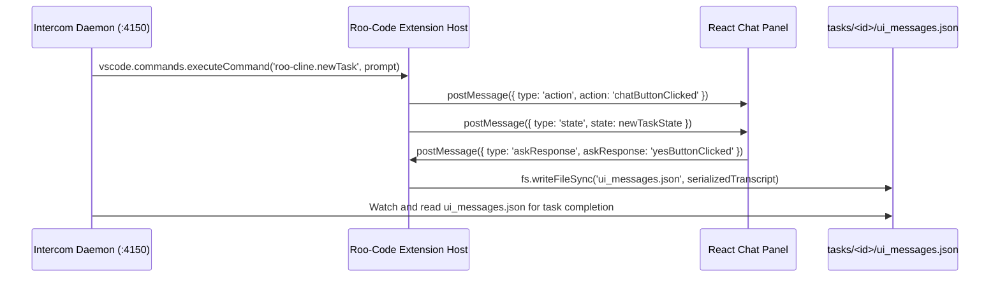
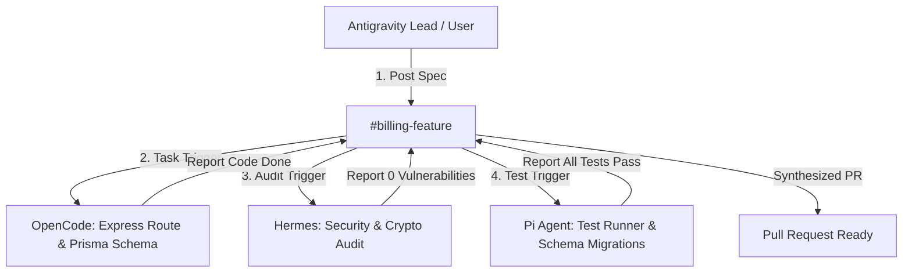

# 🌐 Real-World Multi-Agent Recipes & Harness Orchestration

> **Package**: `@advance/intercom-global` (v2.0.0)  
> **Snapshot Date**: `2026-11-25` · **Last Live Sync**: `2026-11-25T09:50:04.306Z`  
> **Status**: Production Reference & Executable Recipes  
> **Target Engines**: `opencode, claude, hermes, pi, jules, codex, mcode, cursor, windsurf, vscode, antigravity, qoder, custom` (active detected: `opencode, claude, jules, codex, mcode, vscode`)  
> **Default Models**: Primary `opencode/beam-free` · Fallback `opencode/cat-jam-free` · Claude `anthropic/claude-sonnet-4.6` · Jules `gemini-3.6-flash`

This guide provides battle-tested recipes, command flows, and architectural scripts for coordinating heterogeneous AI agents across real-world terminal harnesses, Visual Studio Code extension hosts, and cloud VM execution clusters.

---

## 1. 🏗️ Pattern 1: Claude Code Headless Stdin Pipeline & Session Resumption

### The Real-World Scenario:
You want to run a multi-step refactoring workflow where Step 1 generates an AST audit from a compiler log, and Step 2 executes the patch while continuing the same conversational context—without any interactive confirmation prompts.

### Recipe & Executable Command Flow:

```bash
# Step 1: Pipe test failures into Claude Code in non-interactive print mode (-p)
# Using --dangerously-skip-permissions to allow autonomous directory inspection
npm test 2>&1 | claude -p "Analyze these test failures and generate an AST fix strategy" \
  --dangerously-skip-permissions > /tmp/claude-plan.txt

# Step 2: Continue the conversation in the same repository session (-c)
# Instructing Claude Code to implement the proposed changes and run verification
claude -c -p "Implement the proposed plan from our previous turn and run npm test" \
  --dangerously-skip-permissions
```

### Node.js Orchestrator Implementation (`intercom bridge`):
```javascript
import { spawn } from "child_process";

export function dispatchToClaudeCode(prompt, { continueSession = false } = {}) {
  const args = ["-p", "--dangerously-skip-permissions"];
  if (continueSession) {
    args.push("-c");
  }
  args.push(prompt);

  const child = spawn("claude", args, {
    stdio: ["pipe", "pipe", "pipe"],
    shell: true
  });

  child.stdout.on("data", (data) => console.log(`[Claude]: ${data}`));
  child.stderr.on("data", (data) => console.error(`[Claude Err]: ${data}`));

  return child;
}
```

---

## 2. 🔌 Pattern 2: Roo-Code & Cline Webview IPC Bridge via VS Code Extension Host

### The Real-World Scenario:
An external orchestrator running in a terminal or daemon needs to programmatically inject a coding task into an active VS Code instance running Roo-Code or Cline, track its progress, and read its persistent conversation transcript.

### Architecture Flow:


### Transcript Extraction Script (`scripts/inspect-roo-task.js`):
```javascript
import fs from "fs";
import path from "path";

export function readLatestRooTaskTranscript() {
  const baseDir = process.platform === "win32"
    ? path.join(process.env.APPDATA, "Code", "User", "globalStorage", "rooveterinaryinc.roo-cline", "tasks")
    : path.join(process.env.HOME, "Library", "Application Support", "Code", "User", "globalStorage", "rooveterinaryinc.roo-cline", "tasks");

  if (!fs.existsSync(baseDir)) return null;

  const tasks = fs.readdirSync(baseDir)
    .map((name) => ({ name, fullPath: path.join(baseDir, name), stat: fs.statSync(path.join(baseDir, name)) }))
    .filter((entry) => entry.stat.isDirectory())
    .sort((a, b) => b.stat.mtimeMs - a.stat.mtimeMs);

  if (tasks.length === 0) return null;

  const latestTaskDir = tasks[0].fullPath;
  const uiMessagesPath = path.join(latestTaskDir, "ui_messages.json");
  const taskMetaPath = path.join(latestTaskDir, "task.json");

  return {
    taskId: tasks[0].name,
    metadata: fs.existsSync(taskMetaPath) ? JSON.parse(fs.readFileSync(taskMetaPath, "utf8")) : {},
    transcript: fs.existsSync(uiMessagesPath) ? JSON.parse(fs.readFileSync(uiMessagesPath, "utf8")) : []
  };
}
```

---

## 3. ⚡ Pattern 3: OpenCode CLI Asynchronous REST Dispatch & SSE Telemetry

### The Real-World Scenario:
A central coordinator wants to dispatch a long-running refactoring task to OpenCode without blocking the event loop, streaming back live tool executions over Server-Sent Events (SSE).

### Execution Recipe:
```bash
# 1. Start the OpenCode background server
opencode serve --port 4096 --hostname 127.0.0.1 &

# 2. Initialize a session via REST
SESSION_ID=$(curl -s -X POST http://127.0.0.1:4096/session \
  -H "Content-Type: application/json" \
  -d '{"title": "auth-refactor"}' | jq -r '.id')

# 3. Fire-and-forget asynchronous prompt execution (Returns 204 No Content immediately)
curl -X POST "http://127.0.0.1:4096/session/${SESSION_ID}/prompt_async" \
  -H "Content-Type: application/json" \
  -d '{"prompt": "Refactor token cleanup logic in client/auth.js and run npm test"}'

# 4. Stream real-time execution events
curl -N "http://127.0.0.1:4096/session/${SESSION_ID}/events"
```

---

## 4. 🛡️ Pattern 4: Explicit Free-Tier Qoder Worktree Isolation (Zero-Qoder Safe)

### The Real-World Scenario:
> **Zero-Qoder Invariant**: `qoder` is barred from all automatic routing and default fallback chains (`opencode -> claude -> hermes -> local-mesh (Zero-Qoder enforced)`). Only invoke explicitly using verified free-tier models (`qwen3.8-flash, qwen3.8, qoder/qwen3.8-flash, glm-5.3-flash, deepseek-flash, minimax-m3.1-flash`).

When explicitly dispatching an isolated defect investigation using `qwen3.8-flash` with full thinking effort, guarantee that it runs in an isolated Git worktree so uncommitted changes in your main workspace are never corrupted.

### Configuration (`qoder-settings.json`):
```json
{
  "reasoningEffort": "high",
  "thinking": {
    "mode": "enabled",
    "budget": 4096
  },
  "model": {
    "preferences": {
      "qwen3.8-flash": {
        "reasoning": { "effort": "high" }
      }
    }
  }
}
```

### Command Execution:
```bash
# Spawns Qoder explicitly with verified free-tier model (qwen3.8-flash) in isolated Git worktree
qoder --worktree agent-cell-1 \
  -m "qwen3.8-flash" \
  --settings ./qoder-settings.json \
  --dangerously-skip-permissions \
  -p "Investigate memory leak in WebSocket connection pool, apply surgical fix, and verify test suite"
```

---

## 5. ☁️ Pattern 5: Google Jules Cloud Delegation with 5-Pillar Constraints

### The Real-World Scenario:
A massive 600-line controller file (`client/js/portals/account.js`) needs a complete architectural rewrite to eliminate redirect loops and satisfy the 6-key token cleanup invariant. Instead of bogging down local CPU and context windows, the orchestrator delegates this heavy single-file overhaul directly to Google Jules on a cloud VM.

### Execution Script:
```bash
# Verify pre-flight quota (max 15 concurrent sessions, 100 daily)
ACTIVE_SESSIONS=$(jules remote list --session --output json | jq '.sessions | length')

if [ "$ACTIVE_SESSIONS" -lt 14 ]; then
  jules new "
[PILLAR 1: GOAL]
Refactor client/js/portals/account.js to resolve 401 redirect loop and eliminate legacy token leaks.

[PILLAR 2: TARGET FILE]
client/js/portals/account.js

[PILLAR 3: CONTEXT & DEFECT]
Observed Defect: Users logging out or encountering expired JWTs enter infinite redirect loops between /account.html and /account-dashboard.html.
Root Cause: Incomplete localStorage cleanup leaves stale 'customer_session' and 'auth_token' keys active while 'session_user' is removed.

[PILLAR 4: INVARIANT CONSTRAINTS (FIXING VALUES)]
All implementations must strictly adhere to:
1. Zero inline styles / strict 8px grid spatial layout.
2. WCAG AA 4.5:1 minimum contrast in both light and dark themes.
3. Synchronized 6-key auth token cleanup on any 401 Unauthorized response:
   - localStorage.removeItem('auth_token')
   - localStorage.removeItem('session_user')
   - localStorage.removeItem('customer_session')
   - localStorage.removeItem('customer_session_last_activity')
   - localStorage.removeItem('customer_session_expires')
   - localStorage.removeItem('iot_workspace_authenticated')
4. Zero-loss discrete atomic file operations.
5. No placeholder implementations, real genuine logic only.

[PILLAR 5: VERIFICATION COMMAND]
npm test -- test/account-auth.test.js
Acceptance Criteria:
- Test suite exits with code 0 (100% passing).
- Zero unhandled exceptions or lint warnings.
"
else
  echo "Jules concurrency limit reached ($ACTIVE_SESSIONS / 15). Falling back to local worker_m2."
fi
```

---

## 6. 🏗️ Pattern 6: Full-Stack Feature Swarm (Supervisor-Worker)

### The Real-World Problem:
When building a new full-stack feature (e.g. Stripe checkout + webhooks), doing everything sequentially in a single agent prompt leads to context dilution, forgotten edge cases, or missed cryptographic validations.

### The Solution:
Decompose the feature into specialized roles operating concurrently across a shared topic channel (`#billing-feature`):



### Executable Example:
Run the ready-to-use example:
```powershell
node examples/fullstack-feature-swarm.js
```

---

## 7. 🔍 Pattern 7: Multi-Agent Pull Request Review Pipeline

### The Real-World Problem:
A single reviewer often overlooks niche security risks or API convention breaks.

### The Solution:
Dispatch parallel specialized review tasks whenever a PR diff is submitted:
1. **Hermes Agent**: Scans for OWASP Top 10, timing attacks, header injections, and cryptographic issues.
2. **OpenCode Agent**: Analyzes API contracts, error boundaries, and developer experience.
3. **Pi Agent / Runner**: Validates test coverage and regression impacts.

### Executable Example:
```powershell
node examples/github-pr-review-swarm.js
```

---

## 8. 📊 Pattern 8: Real-Time SSE Observability Dashboard

Monitor all multi-agent messages, broadcasts, and topic channels live in your browser:

1. Start the Intercom HTTP & SSE Daemon (`http://127.0.0.1:4150`):
   ```powershell
   intercom daemon start
   ```
2. Open `examples/live-mesh-dashboard.html` in your browser.
3. Watch live message streams flow between agents in real time, with instant dispatch capabilities from the UI.

---

## 9. 🔀 Pattern 9: Git Worktree Isolation for Parallel Agents

To prevent multiple agents working concurrently from clobbering each other's working directory files:

```powershell
# 1. Create isolated worktrees for each agent
git worktree add ../feature-backend feature/backend-api
git worktree add ../feature-security feature/security-audit

# 2. Run opencode in the backend worktree (model: opencode/beam-free)
node src/bridges/session-bridge.js --agent opencode -- "cd ../feature-backend; opencode"

# 3. Run Hermes in the security worktree
node src/bridges/session-bridge.js --agent hermes -- "cd ../feature-security; hermes chat"

# 4. Notify active peers (antigravity, claude, opencode)
intercom send hermes "Backend branch ready for review (1795604817027_2_28c8d57e-1b2c-43b1-97f4-6c70de4c7328)" --from opencode
```

---

## 10. 🤖 Available Pre-Built Examples in Repository

| Example Script | Description | Supported Engines |
| :--- | :--- | :--- |
| [`examples/fullstack-feature-swarm.js`](../examples/fullstack-feature-swarm.js) | Complete SaaS feature implementation workflow across Antigravity, OpenCode, Hermes, and Pi. | Antigravity, OpenCode, Hermes, Pi |
| [`examples/github-pr-review-swarm.js`](../examples/github-pr-review-swarm.js) | Automated multi-agent code review pipeline generating structured GitHub markdown. | Hermes, OpenCode, Pi |
| [`examples/live-mesh-dashboard.html`](../examples/live-mesh-dashboard.html) | Real-time web dashboard consuming the SSE event bus. | Browser, Intercom Daemon |

---

## 11. 🛡️ Verification & Operational Invariants

Every real-world harness execution must strictly preserve the core architectural invariants:
1. **Zero-Kill Protocol**: Running agents must never be destroyed via `SIGKILL` or process termination; steer via stdin preemption or discrete message mailboxes.
2. **Windows NTFS Safe Retries**: All file operations (`fs.renameSync`, `fs.unlinkSync`) use 5-attempt exponential backoff with randomized jitter.
3. **Headless Stdio Protection**: Never inject raw `\x03` bytes into headless JSON-RPC stdio streams; use `$/cancelRequest` or out-of-band daemon HTTP aborts.
4. **Single-File Heavy Overhaul Bounds for Jules**: Route tasks to Google Jules only when confined to $\le 3$ files and requiring heavy modifications ($\ge 100$ LOC), preserving pre-flight quota gating (15 concurrent, 100 daily).
